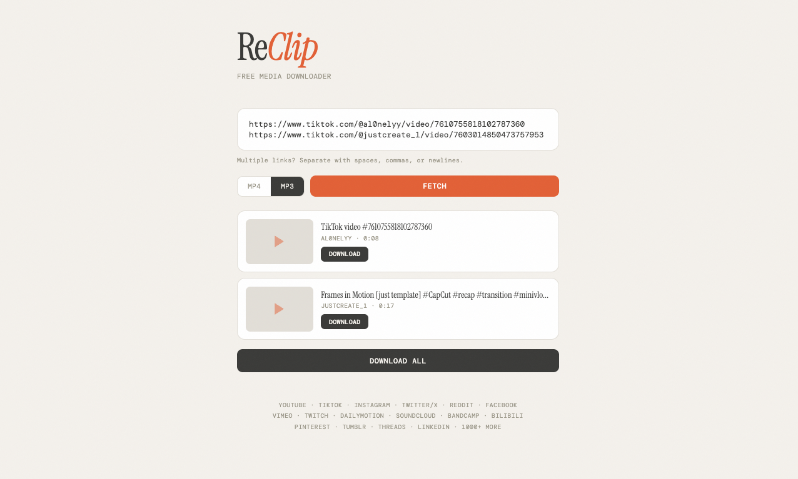

# Video Downloader

Video Downloader is a personal web app for saving video or audio from YouTube and other sites supported by `yt-dlp`. Paste one or more links, choose a format, and track each download in a live queue. When a site needs authentication, the app can automatically use a local `cookies.txt` export without ever storing usernames or passwords in code.

## Tech Stack

- **Backend:** Python + Flask for a simple local web server and JSON API
- **Download engine:** `yt-dlp` for site extraction and `ffmpeg` for audio conversion and media merging
- **Frontend:** Vanilla HTML, CSS, and JavaScript modules for a fast UI with no build step
- **Persistence:** JSON config in `data/app_state.json` for settings and the last 20 downloads

## Installation

### 1. Clone the repo

```bash
git clone <your-repo-url>
cd reclip-main
```

### 2. Create a virtual environment

Windows PowerShell:

```powershell
python -m venv .venv
.venv\Scripts\Activate.ps1
```

macOS / Linux:

```bash
python3 -m venv .venv
source .venv/bin/activate
```

### 3. Install Python dependencies

```bash
pip install -r requirements.txt
```

### 4. Install `ffmpeg`

`ffmpeg` is required for MP3, OGG, and merged MP4 outputs.

Windows:

```powershell
winget install Gyan.FFmpeg
```

macOS:

```bash
brew install ffmpeg
```

Ubuntu / Debian:

```bash
sudo apt update
sudo apt install ffmpeg
```

### 5. Run the app

```bash
python app.py
```

Open `http://127.0.0.1:8899`.

## Cookie Setup

Some YouTube videos require an authenticated browser session. This app supports that by reading a Netscape-format `cookies.txt` file.

1. Install the browser extension **Get cookies.txt LOCALLY** in Chrome or Firefox.
2. Sign in to the site you need in that browser, such as YouTube.
3. Open the video page in the browser to confirm the account can actually watch it.
4. Use the extension to export cookies in Netscape format.
5. Save the exported file as `cookies.txt` inside the repo's `cookies/` folder.

Example path:

```text
reclip-main/cookies/cookies.txt
```

You can also keep the file somewhere else and set the full path in the in-app **Settings** panel.

### Verify it loaded

1. Start the app.
2. Check the status pill in the header.
3. If it shows `Cookie loaded` with a green dot, the file was detected.
4. If it shows `Guest mode - some videos may fail` with a yellow dot, the app did not find a valid cookie file.

## How To Use The App

1. Paste one or more full video URLs into the main input box.
2. Pick a video or audio format preset.
3. Click **Download**.
4. Watch the queue for filename, percentage, speed, ETA, and any plain-English error messages.
5. Use the **Save file** button when a download finishes.
6. Open **Settings** to change the default download folder, default format, or cookie file path.



## Supported Sites

This app supports whatever `yt-dlp` supports. That includes YouTube plus many other services such as Vimeo, TikTok, Instagram, Reddit, Facebook, Twitch, SoundCloud, and more.

Full supported-site list:

- `yt-dlp` supported sites: https://github.com/yt-dlp/yt-dlp/blob/master/supportedsites.md

## Troubleshooting

### 1. "This video needs an authenticated browser cookie."

- Export a fresh Netscape-format `cookies.txt` file.
- Place it in `cookies/cookies.txt` or set a custom cookie path in Settings.
- Make sure the signed-in account can view the video in the browser.

### 2. "That link does not look like a supported video URL."

- Paste the full page URL, including `https://`.
- Avoid shortened or partial links copied from share sheets when possible.

### 3. "This content is blocked in your region."

- Confirm the video is playable in your browser from your current location.
- Try another source that is available in your region.

### 4. "The site is rate limiting requests right now."

- Wait a few minutes and retry.
- If you are using cookies, export a fresh file and try again.

### 5. "ffmpeg is missing, so the app cannot merge or convert media."

- Install `ffmpeg`.
- Restart the app after installation.

## Notes

- Settings are saved in `data/app_state.json`.
- Download history keeps the most recent 20 completed items.
- Credentials are never hardcoded. The app only reads a local cookie export when you provide one.

## License

[MIT](LICENSE)
